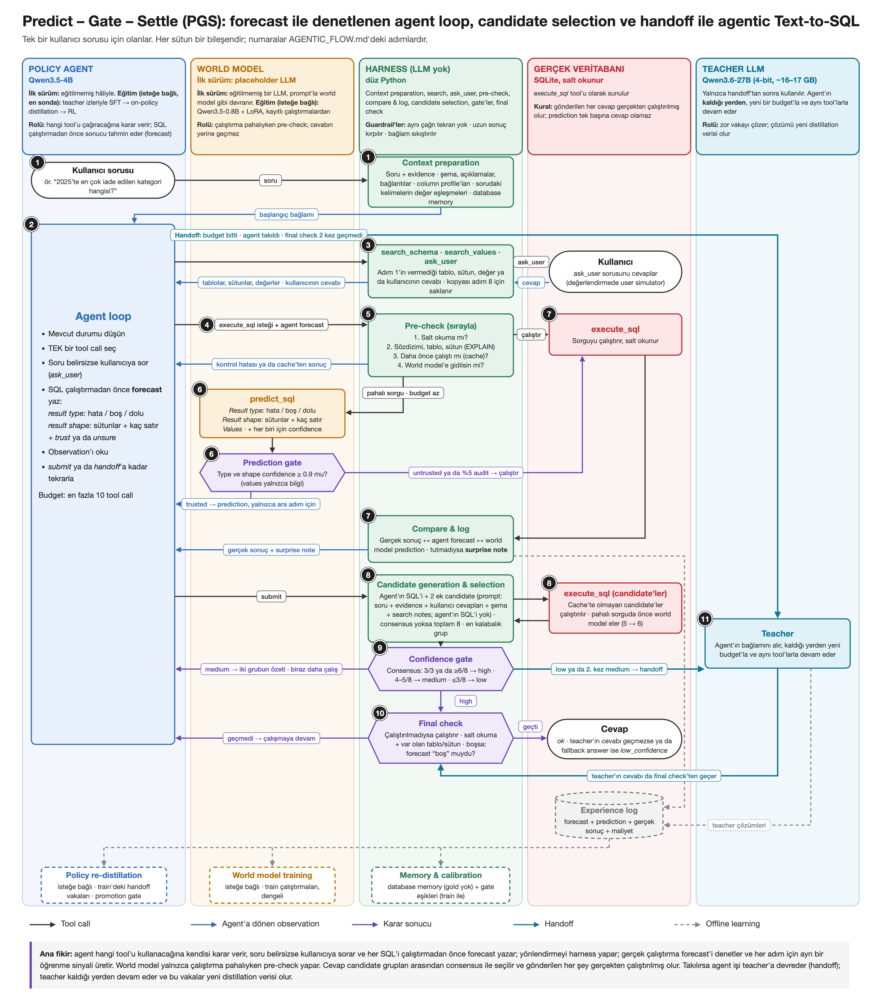

# ForeSQL: Predict – Gate – Settle (PGS)

**Forecast ile denetlenen agent loop, candidate selection ve handoff ile agentic Text-to-SQL.**

Küçük bir policy agent (Qwen3.5-4B), doğal dildeki bir soruyu tool'lar kullanarak SQL'e çevirir. Agent her SQL'i çalıştırmadan önce sonucunun nasıl olacağını tahmin eder (**forecast**); gerçek çalıştırma bu tahmini denetler ve tutmazsa agent'ı uyarır. Cevap, birbirinden bağımsız yazılmış SQL'lerin aynı sonucu vermesiyle (**consensus**) seçilir ve gönderilen her cevap gerçekten çalıştırılmış olur. Soru belirsizse agent kullanıcıya sorar (`ask_user`); takılırsa iş büyük bir teacher modele devredilir (**handoff**). Pahalı sorgularda, sorguyu çalıştırmadan sonucunu tahmin eden bir **world model** devreye girer.

Proje bir ICML makalesi ve ders projesi olarak geliştiriliyor. Ana benchmark BIRD'dür (SQLite, evidence ile).

## Mimari



Her sütun bir bileşendir: 🟦 policy agent, 🟧 world model, 🟩 harness (LLM'siz düz Python), 🟥 gerçek veritabanı, 🩵 teacher LLM, 🟪 harness kararları (gate'ler, final check). Numaralar aşağıdaki adımlardır.

## Bir soru nasıl çözülür

| # | Adım | Kim | Ne olur |
|---|---|---|---|
| 1 | Başlangıç bağlamı | Harness | Şema, sütun açıklamaları, column profile'ları, sorudaki kelimelerin veritabanındaki değer eşleşmeleri ("Los Angles" → `'Los Angeles'`), bu veritabanında daha önce yapılmış hatalar (database memory) |
| 2 | Agent karar verir | Agent | Her turda tek bir tool call: ara, sor, dene, gönder ya da devret. En fazla 10 tool call |
| 3 | Bilgi toplama | Harness | `search_schema`, `search_values`, `ask_user` |
| 4 | `execute_sql` + forecast | Agent | SQL'le birlikte tahmin: hata / boş / dolu, kaç sütun, kaç satır |
| 5 | Pre-check | Harness | Salt okuma mı? `EXPLAIN` hata veriyor mu? Daha önce çalıştı mı (cache)? Pahalı mı ya da budget az mı? |
| 6 | World model + prediction gate | Harness | Yalnızca pahalı sorguda: tahmine güveniliyorsa (confidence ≥ 0.9) sorgu çalıştırılmaz; %5'i yine de denetlenir (audit) |
| 7 | Gerçek çalıştırma | Harness | Sonuç forecast'le karşılaştırılır; tutmadıysa agent'a **surprise note** döner ("dolu bekliyordun, boş geldi") |
| 8 | `submit` → candidate'ler | Harness | Aynı model 2 ek SQL yazar; ayrışırlarsa toplam 8'e tamamlanır. Gerçek sonuçlarına göre gruplanır |
| 9 | Confidence gate | Harness | high (3/3 ya da ≥6/8) → 10 · medium (4–5/8) → iki grubun özeti agent'a döner · low → 11 |
| 10 | Final check | Harness | Cevap gerçekten çalıştı mı, hata yok mu, boşsa bu bekleniyor muydu? |
| 11 | Handoff | Teacher | Teacher agent'ın kaldığı yerden, yeni bir budget'la devam eder |

Örnek: *"2025'te en çok iade edilen kategori hangisi?"* → 1 → 2 → 4 (SQL + "dolu, 1 satır") → 5 → 7 (tahmin tuttu) → 2 → 8 → 9 (3/3 aynı sonuç: high) → 10 → ✔

## Tasarım kararları

| Karar | Neden |
|---|---|
| Forecast'i agent yazar, gerçek çalıştırma denetler | Her adım için ayrı bir öğrenme sinyali (ANTE, ECHO) |
| World model'e gitme kararını harness verir | Agent'lar world model tool'unu ya hiç kullanmıyor ya da yanlış kullanıyor |
| World model yalnızca pahalı sorguda | SQLite'ta çalıştırma ucuz ve kesin; küçük modellerin confidence'ı yeni şemalarda kalibre kalmıyor |
| Son cevap her zaman gerçekten çalıştırılır | Tahmin cevap ya da reward olursa policy onu istismar eder |
| Cevap consensus'la seçilir | Liderlik tablosunun üstündeki sistemlerin ortak yöntemi; harness'ta LLM olmadan ölçülebilen belirsizlik sinyali |
| Harness'ta LLM ve agent framework'ü yok | Her karar düz Python'la, okunur ve tekrar üretilebilir |

Bütün kararlar ve dayandıkları çalışmalar: [docs/AGENTIC_FLOW.md](docs/AGENTIC_FLOW.md).

## Kod

Her dosya akıştaki bir ya da iki adıma karşılık gelir; dosyalar kısa (≤ 150 satır).

| Dosya | Adım | Ne yapar |
|---|---|---|
| `agent/loop.py` | 2 | Agent loop: akışın kendisi; her tool bir dal |
| `agent/policy.py`, `agent/llm.py`, `agent/prompts.py`, `agent/tools.py` | 2, 4, 8 | Modelle konuşma, prompt'lar, tool tanımları |
| `harness/prepare.py`, `harness/value_matches.py` | 1 | Başlangıç bağlamı ve değer eşleşmeleri |
| `harness/search.py`, `harness/ask_user.py` | 3 | Arama tool'ları; kullanıcı ya da user simulator |
| `harness/precheck.py`, `harness/cost.py` | 5 | Ucuz kontroller, cache, world model'e gidilsin mi, cost simulation |
| `world_model/predict.py`, `harness/gates.py` | 6, 9 | World model, prediction gate, audit, confidence gate |
| `harness/compare.py`, `experience/log.py` | 7 | Forecast karşılaştırması, surprise note, experience log |
| `harness/candidates.py`, `harness/final_check.py` | 8, 10 | Candidate'ler ve seçim, final check |
| `harness/handoff.py`, `experience/memory.py` | 11, 1 | Teacher'a devir, fallback answer, database memory |
| `harness/guards.py` | her adım | Guardrail'ler: bozuk çıktı, aynı çağrının tekrarı, uzun sonucun kırpılması, bağlamın sıkıştırılması |
| `db/` | 5, 7 | SQLite: salt okunur çalıştırma, `EXPLAIN`, maliyet tahmini, şema ve profil |
| `evaluate.py`, `report.py`, `mini_interact.py`, `run.py` | | Değerlendirme, sonuç tabloları, Mini-Interact verisi, tek soru |
| `config.py` | | Bütün sabitler ve ablation flag'leri |
| `tests/` | | 103 test; API'siz, küçük bir test veritabanıyla |

Ablation flag'leri: `USE_AGENT_FORECAST`, `USE_CANDIDATES`, `USE_HANDOFF`, `USE_ASK_USER`, `USE_DB_MEMORY`, `USE_WORLD_MODEL`; Phase 2 için `SIMULATE_COST` (bird-coin budget'ı). Ayrıntılar: [docs/KOD_YAPISI.md](docs/KOD_YAPISI.md).

## Durum

Sistem küçük, numaralı aşamalarla kuruldu; her aşama tek bir parça ekler ve testle doğrulanır.

- ✅ **Phase 1 (aşama 1–28):** Akışın 11 adımının hepsi; placeholder world model (prompt'lanan eğitilmemiş bir LLM).
- ✅ **Phase 2 kodu (aşama 30–33):** Mini-Interact (300 belirsiz SELECT görevi), onun kendi user simulator'ü, bird-coin'li cost simulation, prediction gate eşiğinin ölçümü.
- ⏳ **Ölçümler:** Phase 1'in tam ölçümü ve ablation tablosu (aşama 29), makale rakamları için yerel Qwen3.5-4B / Qwen3.6-27B (aşama 35).
- ⏸ **İsteğe bağlı:** World model ve policy eğitimi (SFT → on-policy distillation → RL), DuckDB.

## Sonuçlar

BIRD dev'den sabit 50 soru (seed 0 ile seçilmiş). Doğruluk BIRD'ün resmi kuralıyla: cevabın sonuç kümesi doğru SQL'inkiyle aynıysa doğru.

**Akışın ilk parçaları, API'de Qwen3.5-9B ile:**

| Aşama | Sistem | Seed 0 / 1 / 2 |
|---|---|---|
| 5 | Tool'suz tek SQL (baseline) | %64 / %66 / %62 |
| 6 | Agent loop, tek tool `submit` | %60 / %64 / %66 |
| 7 | + `execute_sql` | %58 / – / – |

**Tam sistem (11 adımın hepsi), yerel Qwen3.5-0.8B ile** (policy, teacher, simulator ve world model aynı küçük model; yalnızca akışın uçtan uca çalıştığını göstermek için):

| Seed | Doğruluk | Ortalama tool call | Gerçek çalıştırma | Teacher'ın cevabı | `ask_user` | World model'e gidiş |
|---|---|---|---|---|---|---|
| 0 | %4 (2/50) | 17.0 | 1.5 | 18 | 8 | 7 |
| 1 | %0 (0/50) | 17.0 | 1.7 | 16 | 6 | 15 |
| 2 | %6 (3/50) | 16.2 | 1.3 | 15 | 6 | 10 |

0.8B model bu iş için çok zayıf: agent forecast'i çoğu zaman yanlış biçimde yazıyor ve guardrail'ler bu çağrıları reddediyor; bu yüzden doğruluk düşük. Tablo, akışın bütün yollarının (handoff, user simulator, world model, candidate'ler) gerçek modelle hatasız çalıştığını gösterir; sistemin başarısını değil. Kayıtlar: `results/asama29_tam_seed*.jsonl`.

50 soruda 1–3 soruluk fark şans sayılır; bu rakamlar ilerlemeyi görmek içindir, makaleye girmez. Makale rakamları aşama 35'te yerel 4B/27B modellerle alınacak.

## Çalıştırma

Apple Silicon (MLX) üzerinde, Python 3.12:

```bash
uv venv --python 3.12 && source .venv/bin/activate
uv pip install -r requirements.txt

# Veri (data/ klasörü depoda yok)
#   BIRD dev: https://bird-bench.github.io → data/bird/dev/ (dev.json, dev_databases/)
hf download birdsql/mini-interact --repo-type dataset --local-dir data/mini_interact

# Yerel model sunucusu (ayrı bir terminalde)
mlx_lm.server --model Qwen/Qwen3.5-0.8B --port 8080 --chat-template-args '{"enable_thinking":false}'

# Tek bir soru: agent'ın her adımını yazar
python run.py --db data/bird/dev/dev_databases/california_schools/california_schools.sqlite "How many schools are in Alameda county?"

# Değerlendirme ve ablation
python evaluate.py --name deneme --seed 0 --subset
python evaluate.py --name deneme_forecastsiz --seed 0 --subset --off USE_AGENT_FORECAST
python evaluate.py --name mini --dataset mini_interact --limit 10 --simulate-cost
python report.py results/deneme_*.jsonl

# Testler (API gerekmez)
pytest tests/ --deselect tests/test_llm.py::test_api_answers
```

Model adresi ve adları `config.py`'dedir; OpenRouter API'sine geçmek birkaç satırdır (dosyadaki yorumda yazıyor).

## Dokümanlar

- [docs/AGENTIC_FLOW.md](docs/AGENTIC_FLOW.md): akışın adım adım anlatımı, terim sözlüğü, tasarım kararları ve kaynakça
- [docs/KOD_YAPISI.md](docs/KOD_YAPISI.md): kod kuralları, dosya haritası, tool'lar, sabitler, kayıt biçimleri, aşamaların sırası
- [docs/ARASTIRMA.md](docs/ARASTIRMA.md): literatür taraması, veri setleri, hiperparametreler
