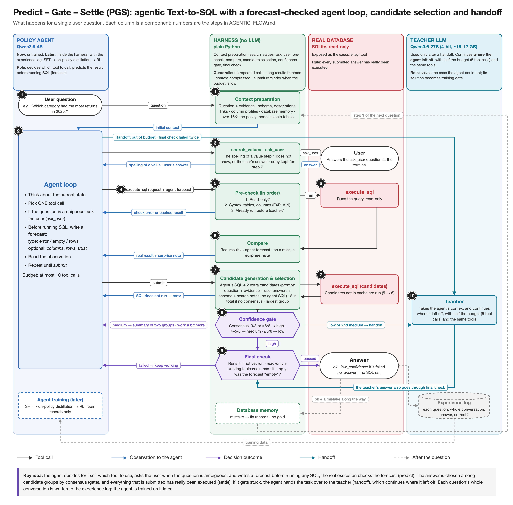

# Predict – Gate – Settle (PGS)

Turkish original: [../AGENTIC_FLOW.md](../AGENTIC_FLOW.md)

**Agentic Text-to-SQL with a forecast-checked agent loop, candidate selection and handoff.**

A small policy agent solves the question with tools; if the question is ambiguous, it asks the user. Before running any SQL, it predicts the result (agent forecast), and the real execution checks this prediction (predict). The answer passes a gate that checks whether independently written SQL queries give the same result (gate), and every answer that is returned has actually been executed (settle). If the agent gets stuck, the task is handed over to a large teacher LLM (handoff). The literature behind the design is in [RESEARCH.md](RESEARCH.md); the structure of the code is in [CODE_STRUCTURE.md](CODE_STRUCTURE.md).

## Flow

**In short:** question → initial context (1) → agent loop: search or ask (3), try SQL (4–6) → `submit` → candidates (7) → confidence gate (8) → final check (9) → answer. If the agent gets stuck, the teacher takes over (10).

| Color | Component |
|---|---|
| 🟦 Blue | Policy agent |
| 🟩 Green | Harness (no LLM) |
| 🟥 Red | Real database |
| 🩵 Turquoise | Teacher LLM |
| 🟪 Purple | Harness decision (confidence gate, final check) |
| ⬜ Dashed | After the question: database memory, experience log, agent training (later) |
| ⚪ White, rounded | Outside the system: the user's question, the user who answers `ask_user`, and the returned answer |

Arrow colors: **black** tool call, **blue** observation returned to the agent, **purple** decision result, **turquoise** handoff, **dashed** after the question.

## Terms

| Term | Meaning |
|---|---|
| Policy agent | The small model that solves the question step by step |
| Tool call | The single request the agent makes in one turn (e.g. `execute_sql`) |
| Observation | The result returned to the agent after a tool call |
| Tool-call budget | The maximum number of tool calls for one question (10) |
| Trial loop | The loop in which the agent searches, asks, tries, looks at the result and fixes (steps 2–6) |
| Column profile | A summary of a column: type, NULL ratio, most frequent values (all of them for columns with few values), min and max if numeric |
| Harness | The plain code around the agent: runs the tools, manages the checks and the gate. No LLM inside |
| Agent forecast | The prediction of the result that the agent writes before running a SQL query |
| Pre-check | The cheap checks the harness makes before a SQL query runs: is it read-only, does `EXPLAIN` fail, is it in the cache (step 5) |
| Cache | The stored results of SQL queries that already ran for the same question; the same SQL is not run again |
| Confidence gate | The decision point that checks whether the candidates agree enough (step 8) |
| Final check | The last check before the answer is returned: did it really run, no error, if empty was that expected (step 9) |
| Candidate | An alternative SQL query written for the same question |
| Consensus | Different candidates giving the same result |
| Adaptive rule | The rule that picks the number of candidates: first 2 extra candidates, 8 in total if they do not agree (step 7) |
| Handoff | Handing the task over to the large teacher model |
| Evidence | The short hint text BIRD gives with each question (e.g. "returned = `status = 'returned'`") |
| `ask_user` | The tool with which the agent asks the user a short clarification question on an ambiguous question (e.g. "count or amount?") |
| Clarification | The user's answer to an `ask_user` question. It counts as part of the question |
| Search notes | A copy of the search results, kept separately for the candidate prompt |
| Surprise note | A short note returned to the agent with the real result when the forecast misses (e.g. "you expected rows, the result is empty") |
| Medium note | The note returned to the agent when the confidence gate says medium: a summary of the two largest candidate groups |
| Database memory | A record of mistakes made and corrected earlier on a database. It is added to the context in step 1 |
| Result key | The key used to compare query results. All rows of the result are taken as a set: row order and duplicate rows do not matter, column order does (BIRD's official rule). Two results with the same key count as "the same result" |
| Fallback answer | The best answer returned when no answer passes the checks; it carries the `low_confidence` label |
| Label | The label of the returned answer: `ok` (passed the checks), `low_confidence` (did not pass but there is an answer), `no_answer` (no SQL that ran) |
| Experience log | The record of each question's whole conversation (every step of the agent and the teacher), the answer and whether it is correct; the agent's training data comes from here |
| Split | A part of the data: train or dev (evaluation). Only train is used for training |
| SFT | Training a model to imitate correct examples |
| On-policy distillation | Training the student model on its own attempts, corrected by the teacher |
| RL | Training a model with rewards and penalties based on the outcome of its attempts |
| Guardrail | The harness rules that protect the agent: no repeated calls, long results are trimmed, the context is compressed when full |
| EXPLAIN | The database showing its plan for a query without running it. In SQLite it also catches syntax errors and missing tables/columns without running |
| Seed | A number that fixes randomness; repeating with different seeds shows that a result is not luck |
| Phase / stage | Phase: a large period (Phase 1 BIRD, Phase 2 Mini-Interact). Stage: a small numbered piece of work that adds a single part (CODE_STRUCTURE.md "Build order") |

## Components

- **Policy agent (Qwen3.5-4B):** Decides which tool to call at each step. Predicts the result before running SQL. Used untrained for now; later it is trained inside the harness with the experience log.
- **Harness (plain Python, no LLM):** Runs the tools, makes the checks, manages the confidence gate and the final check. It also applies the guardrails.
- **Database (SQLite, read-only):** `execute_sql`.
- **User:** Answers `ask_user` questions. The question always comes to the terminal, in `run.py` and in `evaluate.py` alike. The person running the experiment answers in one sentence, like a user who knows what the question means; they do not reveal the SQL or the result. The correct SQL never enters the agent's context; it is used only for scoring.
- **Teacher LLM (Qwen3.6-27B, 4-bit):** Used only after a handoff. Continues where the agent left off.

## The flow step by step

The numbers in the figure are these steps. The division of work is simple:
- **The agent** decides what to do: which tool, which SQL, the forecast, what to ask the user, when to `submit`.
- **The harness** decides everything else: the checks, the candidates, the confidence gate, the final check, the handoff.

Tool arguments and numeric limits are in [CODE_STRUCTURE.md](CODE_STRUCTURE.md).

### 1. Initial context

**Why:** Every search costs a tool call. If the information is given up front, the budget is left for trying.

The harness gives the agent:
- The question and, if any, the evidence.
- The schema: tables, columns, BIRD's column descriptions, foreign keys.
- Column profiles. For text columns, the 10 most frequent values (for columns with at most 10 distinct values, e.g. `status`, all values); the agent finds the remaining values with `search_values` if needed. For numeric columns, only the smallest and largest value.
- Database memory: mistakes made earlier on this database and their corrections (the 3 records most similar to the question).

The context is at most 16K tokens. If it overflows, an LLM selects the tables the question needs (schema linking): the schema is split into chunks that fit, the model writes the names of the needed tables from each chunk, and the selections are joined. Tables that are not selected shrink to one line (only column names and types). The model does not rewrite the schema, it only selects tables, so it cannot invent a column. On BIRD dev and Mini-Interact the context never exceeds this limit (the largest is ~14K).

Database memory example: in an earlier question the agent wrote `status = 'iade'` (Turkish for "returned"), the result came back empty, and it then corrected this to `'returned'`. This mistake and its correction are recorded; in a new question about returns, the agent sees it from the start.
→ 2

### 2. The agent decides what to do

The agent makes a single tool call each turn:
- If it does not know how a value is written in the database → `search_values` → 3
- If the question is ambiguous and the schema, values or evidence do not resolve it → `ask_user` → 3
- If it wants to try a SQL query → `execute_sql` → 4
- If it is confident in the answer → `submit` → 7

After every observation the agent returns here. Every tool call takes one off the budget (at most 10). Rejected requests and outputs that cannot be read as a tool call also count; the error is returned to the agent. When 2 tool calls are left, a reminder is added under the result: "if a query you ran answers the question, submit it now". If the budget runs out, the harness forces a handoff → 10.

**Guardrails.** Small models often make certain typical mistakes; so that these do not break the system, the harness applies three simple rules at every step (DualSQL).
1. **No repeats:** If the same call (same tool, same arguments) comes a second time, it is not run; a "you already tried this" note and the earlier result are returned, and the budget still goes down. For `execute_sql` only the SQL is considered. `submit` is the exception: resending the same SQL after a medium note is a valid choice.
2. **Long results are trimmed:** The agent sees at most 20 rows, with the total number of rows next to them.
3. **The context is compressed:** If the conversation exceeds 32K tokens, the oldest results shrink to a one-line summary (e.g. "Columns: name | 358 rows").

### 3. Gathering information: `search_values` and `ask_user`

The agent can use these whenever it wants. Since step 1 is rich, they are rarely needed for most questions.
- **`search_values`:** Finds in which column, and as which value, a word appears in the database, including similarly spelled values. Example: "Los Angles" → `city = 'Los Angeles'`.
- **`ask_user`:** A short question is asked only if only the user can clarify the question. Example: "count or amount?" → "count". At most 5 times per question (agent and teacher combined).

Search cannot find everything: if the question says "iade" (Turkish for "returned") and the database says `'returned'`, they do not match. In this case the evidence usually provides the match; if it does not, the agent asks the user, or gets an empty result with the wrong value and the surprise note steers it to try another value.

The result is returned to the agent as an observation. The harness also keeps a copy: search results as **search notes**, the user's answers as **clarifications**. Both are given to the candidates in step 7. Why a copy? The candidates do not see the agent's history; if they did, they would copy the agent's SQL. Thanks to the copy they get the information that was found (e.g. `'returned'`), not the SQL.
→ 2

### 4. The `execute_sql` request and the forecast

Along with the SQL, the agent also predicts what the result will be (forecast). These are arguments of `execute_sql`:
- `type` (required): `error`, `empty` or `rows`.
- `columns` and `rows` (for `rows`, when it can): the expected columns and row range (`0`, `1`, `2-10`, `11-100`, `100+`).
- `trust` (optional): confident or not.

Example: `execute_sql(sql="SELECT ...", type="rows", columns=["category", "n"], rows="1", trust=true)`

If `type` is missing, or a field's format is broken, the request is rejected (→ 2). Small format mistakes are fixed (e.g. `"true"` → `true`, `358` → `"100+"`); the fields are also accepted inside a nested `forecast` object.
→ 5

### 5. Pre-check

**Why:** To catch a broken query the cheap way, without running it.

The agent's SQL queries, the candidates and the final check go through here. The harness asks three questions in order:
1. **Does it write?** If it does not start with `SELECT` or `WITH`, it is rejected. Example: `DELETE FROM orders`.
2. **Is it broken?** `EXPLAIN` catches syntax errors, missing tables and columns without running the query. If a missing column exists in another table, the note says so.
3. **Did it already run (cache)?** If so, it is not run again; the stored result is used. Example: a candidate rewrites the agent's SQL exactly.

The note of a query stopped at 1–2 is returned to the agent (→ 2).
→ 6

### 6. Real execution and comparison

The query runs read-only on the database (at most 30 seconds) and the real result is compared with the agent's forecast.
- For the forecast to count as a hit, the result type must match; for `rows`, the number of columns and the row range must match too, if they were written. Column names are not compared, because the same column can come with a different alias.
- The real result (trimmed) is returned to the agent. If the forecast missed, a surprise note comes with it. Example: "you expected 1 column and 100+ rows, the result is empty".
→ 2

> Steps 2 → 6 are the agent's **trial loop**: search, ask, try, look at the result, fix.

### 7. `submit` → candidates

**Why:** A SQL query running without errors does not show that it is correct. The strongest signal is independently written SQL queries giving the same result (consensus).

- **First:** If the submitted SQL does not run (it fails the pre-check or gives an error), no candidates are generated; the error goes back to the agent (→ 2).
- **Who writes them:** The agent's SQL is also a candidate. The others are written by the same policy model, tool-free, in one go. The prompt contains the step 1 context, the search notes and the clarifications. The agent's SQL is not put into the prompt; if it were, the model would copy it.
- **How many (adaptive rule):** First 2 extra candidates. If they all give the same result as the agent's SQL, it stops. If they disagree, the total is filled up to 8.
- **How they run:** Each candidate goes through steps 5–6 (without a forecast). A SQL that already ran comes from the cache. Candidates do not take from the budget, and their results are not returned to the agent (the only exception is the medium note in step 8).
- **Grouping:** Candidates with the same result key, i.e. the same real result, form a group. A candidate that gives an error joins no group.
- **Selection:** The largest group is selected. On a tie, the group containing the earliest candidate; the agent's SQL comes first, so its group wins. The group's answer is its first SQL.
- **Second `submit`:** If the agent submits again after a medium note or a final check note, the candidates are generated from scratch, because the search notes and clarifications may have changed.
→ 8

### 8. Confidence gate

The decision looks only at consensus: how many candidates are in the largest group?
- **High:** 3/3 or at least 6 of 8 → 9.
- **Medium:** 4–5 of 8 → a medium note is returned to the agent → 2. The note shows the two largest groups: a representative SQL, how many candidates it is in, the columns, the number of rows, the first 3 rows. The agent can pick one and submit again, make a new attempt, or ask with `ask_user`. This happens at most once; a second medium → 10.
- **Low:** at most 3 of 8 → 10.

### 9. Final check

The last check before the answer is returned:
- **Is it read-only, do the tables and columns exist?** (step 5)
- **Does it really run?** If it has not run (e.g. the teacher's answer), the harness runs it now; so every returned answer has really been executed. An answer that gives an error does not pass.
- **If the result is empty, was that expected?** If the last forecast written for this SQL is not "empty", or there is no forecast, it does not pass.

Passes → **the answer is returned ✔** (label `ok`). Does not pass → the reason is returned to the agent as a note → 2. If it fails a second time → 10.

### 10. Handoff

The harness makes the handoff: out of budget, confidence low, medium a second time, the final check failed twice.
- The teacher does not start from scratch; it continues where the agent left off: it sees the whole conversation and the reason for the handoff.
- It works with a new budget of half the agent's (5 tool calls) and the same tools (steps 2–6). For `ask_user` it uses only the question's remaining allowance.
- The teacher's `submit` does not go to the candidates but straight to the final check. If it passes, `ok`. If not, it is not retried: if the SQL runs (e.g. an unexpected empty result) it is returned with `low_confidence`; if it does not run at all, the fallback answer is returned. If the teacher does not submit within its budget, the fallback answer is returned too.

**Fallback answer** order: the SQL most recently selected in step 7 → otherwise the candidates' consensus (the model writes 8 tool-free SQL queries, the largest group's SQL) → otherwise the most recent SQL that ran without error → otherwise no answer. The first three are returned with the `low_confidence` label, the last with `no_answer`. A SQL that does not run is never the answer.
→ Answer ✔

**The returned answer:** the SQL, the label (`ok`, `low_confidence`, `no_answer`) and who found the answer (agent or teacher).

### Two examples

**Example 1 ("Which category had the most returns in 2025?"):**
1 (evidence: returned = `status = 'returned'`) → 2 → 4 (SQL + forecast: "rows, 1 row") → 5 → 6 (real result, forecast hit) → 2 → 7 → 8 (high: 3/3) → 9 → ✔

**Example 2 (same question, if the candidates disagree):**
1 → 2 → 4 → 5 → 6 → 2 → 7 → 8 (medium: 5 of 8 candidates count items, 3 sum the amount; the medium note shows both groups) → 2 → 3 (`ask_user`: "count or amount?" → "count") → 2 → 7 (the clarification is now in the prompt) → 8 (high: 7/8) → 9 → ✔

### After the question

**Database memory:** Written after the answer is returned, from the question's own conversation. If the question ended with `ok`, there was an error or a surprise note along the way, and the answer SQL differs from that mistaken SQL, a record is written: the question, the first mistaken SQL, the note it got, the answer SQL. If the SQL did not change, the mistake was in the forecast, not the query; the record would teach nothing. Gold is not used. `evaluate.py` starts every experiment with an empty memory.

**Experience log:** When a question ends, wherever it was run from (`run.py`, `evaluate.py` or an application in use), one line is written: the whole conversation the agent (and, after a handoff, the teacher) saw, the answer and the label. In evaluation, whether the answer is correct is also written (`split = dev`); in use there is no correct SQL, so this field stays empty (`split = use`), and the training signal there is the teacher's solutions, the label and the user's answers. Records accumulate and are never deleted.

**Agent training (later):** The agent is trained inside the harness it will be used in, with the records in the experience log: first SFT on the teacher's correct solutions, then on-policy distillation (the agent's own attempts, corrected by the teacher), then RL (reward: whether the answer is correct, plus whether the forecast hit). Only records from the train split are used for training.

## Design decisions

| Decision | Why | Basis |
|---|---|---|
| The agent writes the forecast, the real execution checks it | The agent sees its mistake by comparing the result with the prediction it made before looking | ANTE, ECHO |
| The final answer is always really executed | Whether an unexecuted SQL is correct cannot be known | — |
| Candidate generation & selection | The common method of the top systems on the leaderboard | Agentar-Scale-SQL, SIRIUS-SQL |
| Results are compared with BIRD's official rule (result key) | Candidate grouping and scoring use the same measure; "the same result" is defined in one place | BIRD |
| The `ask_user` tool is always on | Asking instead of guessing on an ambiguous question; agents give up on clarification questions too early | BIRD-Interact, PlanPool |
| If the context limit is exceeded, an LLM selects tables (schema linking) instead of summarizing the schema | Since the model selects table names, it cannot invent a column | MAC-SQL (Selector) |
| Step 1 gives as much information as possible (column descriptions, column profiles) | Every search costs a tool call. If the information comes up front, the budget is left for trying, and the candidates get the same information | DualSQL, HarnessSQL |
| The uncertainty signal is candidate disagreement (medium note) | The harness has no LLM and cannot understand uncertainty itself. Disagreeing candidate groups are a measurable sign; the decision is the agent's | SIRIUS-SQL, PlanPool |
| The teacher continues where the agent left off | What the agent found is not wasted; handoff records become training data directly | OLIVE, OVCSD |
| The agent is trained inside the harness | A model trained outside the harness drops from 30.4 to 9.6 when used in the harness | HarnessSQL |
| Database memory does not use gold | Evaluation answers do not leak into the system | — |
| Fixed thresholds and only the consensus rule | Simple and explainable; no separate verifier model is needed | What Predicts Correctness, SIRIUS-SQL |

## Build order

The system was built in small, numbered stages; each stage added a single part and was tested. The list is in the "Build order" section of [CODE_STRUCTURE.md](CODE_STRUCTURE.md).

1. **Phase 1, SQLite + BIRD:** foundation (database, scoring, initial context), first working agent, trial loop (guardrails, `search_values`, forecast), verifying the answer (final check, candidates, confidence gate, medium note), help and memory (handoff, `ask_user`, database memory).
2. **Phase 2, Mini-Interact:** `ask_user` on deliberately ambiguous questions.
3. **Local models:** The policy and the teacher run locally.
4. **Agent training (later):** SFT → on-policy distillation → RL with the experience log.

## Evaluation

- **BIRD dev:** 1,534 questions, with evidence. Accuracy is measured with BIRD's official rule: an answer is correct if its result key is the same as the gold SQL's.
- **Mini-Interact:** 300 ambiguous questions; the real test of `ask_user`. Its correct SQLs are requested by email; until they arrive, the questions run but are not scored.
- **For a test,** 5–10 questions are enough (`--limit 10`). Comparisons use at least 3 seeds (0, 1, 2).
- **Ablations:** When the contribution of a part is to be measured, a flag that turns that part off is added; currently every part is always on.

All thresholds are starting values; they are tuned by measurement.

## References

Only the works that directly shaped this design. The full survey is in [RESEARCH.md](RESEARCH.md).

**Agent forecast**
- ANTE: Anticipate, Then Execute ([2610.15368](https://arxiv.org/abs/2610.15368)): the agent writing a forecast before execution (step 4).
- ECHO: Terminal Agents Learn World Models for Free ([2605.24517](https://arxiv.org/abs/2605.24517)): the real execution checking the forecast (step 6).

**Pre-check and gate**
- CYGNET ([2606.04645](https://arxiv.org/abs/2606.04645)): cheap structural checks first (step 5).
- CacheRL ([2606.14179](https://arxiv.org/abs/2606.14179)): a cache of real executions (step 5).
- What Predicts Correctness in Text-to-SQL? ([2607.06799](https://arxiv.org/abs/2607.06799)): confidence signals (step 8).

**Candidate selection**
- Agentar-Scale-SQL ([2509.24403](https://arxiv.org/abs/2509.24403)): candidate generation & selection (step 7).
- SIRIUS-SQL ([2606.01246](https://arxiv.org/abs/2606.01246)): grouping candidates by result; consensus alone being a strong signal (steps 7, 8).
- Knowing When to Stop ([2607.03991](https://arxiv.org/abs/2607.03991)): stopping sampling early when candidates agree (step 7).

**Asking the user**
- BIRD-Interact ([2510.05318](https://arxiv.org/abs/2510.05318)): the cost of the `ask` action and ambiguous questions (step 3).
- PlanPool ([2610.02739](https://arxiv.org/abs/2610.02739)): agents giving up on clarification questions too early (steps 3, 8).

**Harness**
- HarnessSQL ([2610.12274](https://arxiv.org/abs/2610.12274)): training the agent inside the harness it will be used in; the tool set; the choice of teacher (Qwen3.6-27B).
- DualSQL ([2609.18135](https://arxiv.org/abs/2609.18135)): guardrails (repeated calls, format errors).
- MAC-SQL ([2312.11242](https://arxiv.org/abs/2312.11242)): an LLM selecting the tables the question needs when the schema is long (step 1).

**Handoff and memory**
- OLIVE ([2609.36246](https://arxiv.org/abs/2609.36246)) and OVCSD ([2607.27937](https://arxiv.org/abs/2607.27937)): the teacher continuing where the agent left off (step 10); on-policy distillation.
- Measuring Crystallization in Text-to-SQL ([2608.07213](https://arxiv.org/abs/2608.07213)): writing corrections to the database memory (step 1).

**Evaluation**
- BIRD ([2305.03111](https://arxiv.org/abs/2305.03111)): the main benchmark, evidence and the official result comparison rule.
- BIRD-Interact ([2510.05318](https://arxiv.org/abs/2510.05318)): Mini-Interact.
